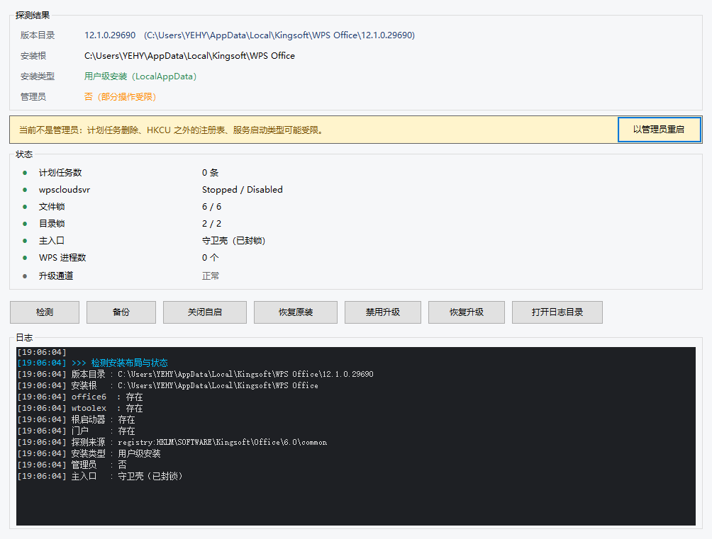

# WPS Autostart Killer

> 彻底关闭 WPS Office 的开机自启，同时封死升级通道，并且随时可以完整恢复原装。
> 适用于被「WPS 开机自己弹出来」困扰、在任务管理器启动项 / 安全软件 / 任务计划程序里删了又回来的人。


---

## ⚠️ AI 生成声明（请先读这一段）

**本项目由 AI 生成。** 这一点必须说清楚，因为它直接决定你该怎么用它。

| 项目 | 说明 |
|---|---|
| 代码来源 | `src/`、`scripts/` 下的全部代码由 AI 编写（Claude / DeepSeek 系列模型，通过多智能体协作：文档、GUI、独立验收三个角色分工）。 |
| 文档来源 | `docs/` 下的三份文档由 AI 撰写，其中的命令经过语法解析与实机执行验证。 |
| 人工介入 | 需求定义、验收判定、最终取舍由人类负责；AI 负责实现与自测。 |
| 测试环境 | 在一台真实 Windows 10（19041）机器上对 **WPS Office 12.1.0.29690（用户级安装）** 做过完整实测，含多次重启验收。 |
| 已验证项 | 见下方 [实测记录](#实测记录)。**未列出的组合不代表可用。** |
| 未验证项 | 其他 WPS 版本、WPS 2019 / 专业版 / 政企版、`Program Files` 全局安装场景、Windows 7 环境。 |

**使用前请你自行审阅代码。** 这个工具会修改文件 ACL、替换可执行文件、改写注册表值——都是侵入性操作。AI 生成的代码可能在你环境里出现作者没预料到的行为，请先看 [从源码构建](#从源码构建) 自己编一份，或者先跑 [命令行探测模式](#先探测再动手) 确认它认得你的安装布局。

**没有担保。** 见 [LICENSE](LICENSE)，MIT 协议，按原样提供。

---

## 目录

- [它解决什么问题](#它解决什么问题)
- [为什么常规办法无效](#为什么常规办法无效)
- [核心思路：五道闸](#核心思路五道闸)
- [两种形态，挑一个](#两种形态挑一个)
- [快速开始](#快速开始)
- [界面说明](#界面说明)
- [禁用 WPS 升级](#禁用-wps-升级)
- [完整可回滚](#完整可回滚)
- [从源码构建](#从源码构建)
- [项目结构](#项目结构)
- [实测记录](#实测记录)
- [已知限制](#已知限制)
- [FAQ](#faq)
- [English Summary](#english-summary)

---

## 它解决什么问题

WPS Office 会在开机后自己启动。你在「任务管理器 → 启动」里找不到它，用火绒/360 的启动项清理也清不掉，在「任务计划程序」里删掉它的任务，过几天又回来了。

本项目解决三件事：

1. **开机不启动 WPS** —— 但桌面 / 开始菜单 / 任务栏固定图标照常能打开，图标也是原来的 WPS 图标
2. **封死升级通道** —— 让它检测不到新版本，不会偷偷升级（可选，手动版与自动版都支持）
3. **随时完整恢复原装** —— 一条命令回到动手前的状态，文件哈希逐字一致

---

## 为什么常规办法无效

因为 **WPS 的自启根本不在 `Run` 注册表里**。它有三层机制：

### 第 1 层：两条以你自己身份注册的计划任务

```
\WpsUpdateTask_<用户名>        每小时重复
\WpsUpdateLogonTask_<用户名>   登录后延迟 29 分钟
    动作：…\WPS Office\ksolaunch.exe /wpsupdate -from=task -source=task
```

### 第 2 层：更新器会重建任务（决定性证据）

`%APPDATA%\kingsoft\office6\log\update\wpsupdate_<日期>.log` 里的真实记录：

```
13:10:51  kupdate::Execute cmd=[-createtask]        ← 创建计划任务
13:11:31  kupdate::Execute cmd=[-repairtask]        ← "修复"计划任务
13:11:31  I  run repair schd exec success
```

**删多少次，它就用 `-createtask` / `-repairtask` 重建多少次。** 这是它的自愈设计，不是操作失误——所以任何「删条目」的思路在原理上必然失败。

### 第 3 层：安装完自己拉起

```
wps.exe /prometheus /from=autostart_after_install
```

所以「开机后 WPS 自己蹦出来」里，有一半是更新器装完自己打开的，而不是传统意义的启动项。

---

## 核心思路：五道闸

既然删条目无效，那就**在文件系统层面拿走载荷的执行权**，同时用一个「守卫壳」保住图标的可用性。

| 闸 | 目标 | 手段 | 权限 |
|---|---|---|---|
| 闸1 | 两条计划任务 | `schtasks /change /disable` + `/delete` | 管理员（DACL 受限时必需） |
| 闸2 | `wpscloudsvr` 服务 | `sc config ... start= disabled` | 管理员 |
| 闸3 | 4 个更新/自启载荷 | `icacls /deny` 精确权限位 | 本人账户即可（用户级安装） |
| 闸4 | 根目录 `ksolaunch.exe` 这个共用入口 | 换成自编译守卫壳 | 本人账户即可 |
| 闸5 | 升级检测的三处服务器地址 | 注册表改指向 `127.0.0.1:9` | 本人账户即可 |

### 闸4：守卫壳是什么

WPS 主图标和计划任务**共用同一个** `%LOCALAPPDATA%\Kingsoft\WPS Office\ksolaunch.exe`。直接禁执行会把图标一起废掉，所以把它换成一个自编译的小程序：

- 参数经过 **token 精确匹配**，命中 `wpsupdate` / `createtask` / `repairtask` / `from=task` / `source=task`，或任意 token 含 `autostart` → **静默退出**
- 其余参数（包括点图标的 `/prometheus /fromksolaunch /from=startmenu`）→ **转发给 `office6\wpsoffice.exe`**，正常打开
- 每次调用写日志到 `%LOCALAPPDATA%\Kingsoft\wps-guard.log`

### 四个踩过的坑（也是本项目的判定依据）

| # | 坑 | 正确做法 |
|---|---|---|
| 1 | `icacls` 简写 `W` 是泛型写权限，会连带拒绝 `READ_CONTROL`，导致文件读不了、WPS 起不来 | 只用精确权限位 `(X,WD,AD,WEA,WA,DE)` |
| 2 | 用「子串包含」判断命令行参数会误伤：`/prometheus` 是正常启动标志；`from=task` 是 `from=taskbar` 的子串 | 切分参数、去掉前导 `-`/`/`、逐 token 精确比对 |
| 3 | 换掉入口 exe 后图标变成默认程序图标（快捷方式图标取自目标 exe 资源） | 编译时加 `/win32icon:`，图标从原版 exe 提取 |
| 4 | 替换前不解除 DENY，重命名直接 `Access is denied` | 先 `icacls /remove:d`，改完再重新上锁 |

---

## 两种形态，挑一个

| 形态 | 目录 | 适合谁 |
|---|---|---|
| **手动配置版** | [`docs/手动操作手册.md`](docs/手动操作手册.md) | 想完全掌控每一步、需要留审计记录、要给别的机器照着做、或想搞懂原理 |
| **自动版 GUI** | [`dist/WpsAutostartKiller.exe`](dist/WpsAutostartKiller.exe) | 只想点几下完事 |

两者做的是同一件事、用同一套判定口径（同样的 ACL 权限位、同样的参数拦截集合、同样的升级地址改写）。可以先用自动版跑通，再拿手册核对它到底改了什么。

---

## 快速开始

### 自动版

```
双击 dist\WpsAutostartKiller.exe
   → 点「检测」      确认它认出了你的 WPS 版本目录
   → 点「备份」      生成 backup-<时间戳> 目录（务必保留）
   → 想关开机自启：点「关闭自启」
   → 想封升级通道：点「禁用升级」
   → 两个都想做：各点一次，互相独立，顺序随意
   → 重启电脑，观察开机后 WPS 有没有自己出来
```

程序启动时会自动检测，**不会**在你点按钮之前做任何修改。危险操作都有二次确认。

### 手动版

打开 [`docs/手动操作手册.md`](docs/手动操作手册.md)，从「第 0 章 · 5 分钟速查表」开始照着敲。每一步都写了：做什么 / 预期输出 / 失败怎么办 / 怎么回退。

### 先探测，再动手

不想装任何东西、只想看看它是否认得你的环境：

```powershell
cd scripts
powershell -ExecutionPolicy Bypass -File .\WPS-Autostart-Portable.ps1
```

只读探测，输出：版本目录 / 安装根 / 用户级还是全局 / `wtoolex` 在不在 / 发现哪几条计划任务 / 哪个服务。**不改任何东西。**

确认无误后再执行：

```powershell
powershell -ExecutionPolicy Bypass -File .\WPS-Autostart-Portable.ps1 -Apply -DryRun   # 演练
powershell -ExecutionPolicy Bypass -File .\WPS-Autostart-Portable.ps1 -Apply           # 真执行
powershell -ExecutionPolicy Bypass -File .\WPS-Autostart-Portable.ps1 -Restore         # 回滚
```

---

## 界面说明



- **顶部**：探测结果（版本目录、安装根、安装类型、管理员状态）
- **状态区**：7 行状态灯 —— 计划任务数 / `wpscloudsvr` / 文件锁 / 目录锁 / 主入口 / WPS 进程数 / 升级通道
- **按钮**：检测 · 备份 · 关闭自启 · 恢复原装 · 禁用升级 · 恢复升级 · 打开日志目录
- **底部**：带时间戳的实时日志

非管理员时顶部会显示黄条并提供「以管理员重启」。用户级安装（`%LOCALAPPDATA%`）普通权限即可完成绝大部分操作；`Program Files` 全局安装必须管理员。

---

## 禁用 WPS 升级

WPS 的升级检测是三步链路：

```
更新器读 HKCU\SOFTWARE\Kingsoft\Office\6.0\Common\UpdateSvr
      → POST 一个 XML（带当前 version / productid / buildid）
      → 服务器回版本清单，比较后提示"发现新版本"
```

**把第 1 步的服务器地址改成本机黑洞，第 2 步就永远失败。**

```
原值：
  UpdateSvr    = http://update.wps.cn/updateserver/update;http://update2.wps.cn/updateserver/update
  UpdateSecSvr = https://update.wps.cn/updateserver/update;https://update2.wps.cn/updateserver/update
  NotifySvr    = http://notify.wps.cn/notifyserver/notify

改为：
  UpdateSvr    = http://127.0.0.1:9/updateserver/update
  UpdateSecSvr = https://127.0.0.1:9/updateserver/update
  NotifySvr    = http://127.0.0.1:9/notifyserver/notify
```

**为什么是 `127.0.0.1:9`**：9 是 discard 端口，本机没有程序监听，连接会被**立即 RST 重置**。换成不存在的域名会等 DNS 超时，WPS 每次启动卡十几秒；换成黑洞 IP 会等 TCP 超时，卡更久。回环地址不产生任何外网流量。

### 升级状态的三态判定

| 状态 | 条件 | 含义 |
|---|---|---|
| **已禁用** | 三个值全部指向 `127.0.0.1:9` | 闸5 生效 |
| **正常** | 三个值全是 `wps.cn` 原值 | 没做，或已还原 |
| **未知** | 只有一部分被改 / 值缺失 | 改到一半或被部分重置，需补齐 |

> **判定陷阱**：`updateinfo\cacheStatusInfo\wpsUpdateStatus = UpdateError` 在闸3 在位时**恒为 `UpdateError`**（更新器根本跑不起来），它证明的是闸3 生效，**不足以证明闸5 生效**。要验闸5，看更新日志最后写入时间是否停止前进，或按手册 12.5 判定 B 做一次解耦验证。

---

## 完整可回滚

两个功能**分开回滚**，互不影响：

| 想撤销 | 自动版 | 手动版 |
|---|---|---|
| 只恢复升级 | 点「恢复升级」 | 手册第 12 章 · 12.6 |
| 只恢复自启 | 点「恢复原装」 | 手册第 9 章 · 五步 |
| 两个都恢复 | 先「恢复升级」再「恢复原装」 | 两章分别执行 |

回滚后的复核判据：

- `ksolaunch.exe` 的 SHA256 与备份里的原始值**逐字一致**
- 两个计划任务重新注册成功且状态为 `Ready`
- `wpscloudsvr` 服务恢复 `Manual`
- 三个升级地址回到 `wps.cn` 多地址原串

### 备份与防污染

备份目录 `backup-<时间戳>\` **累加不覆盖**，每次点击生成独立目录。内容包括：

```
acl-before.txt             每个对象的 ACL 现状
hash-before.csv            5 个载荷文件的 SHA256
HKCU-Kingsoft.reg          注册表整键导出（约 11.5 MB）
service-before.txt         服务原启动状态
manifest.json              总账本（含 upgradeValues / fileRecords / runValues）
upgrade-before.json        三个升级服务器原值（含分号多地址原串）
```

**防止「备份被写坏」的三道保护**：

1. 重复点「禁用升级」是**幂等**的 —— 已处于禁用状态时直接跳过，不写注册表也不动备份
2. 已有**干净**备份时**不覆盖**，新快照另存为 `upgrade-before-<时间戳>.json`
3. 恢复时**跳过**任何 `originalValue` 含 `127.0.0.1` 的备份文件，自动往下一级找；写回前还有一道断言拒绝把黑洞值写进注册表

---

## 从源码构建

只依赖 Windows 自带的 .NET Framework 编译器，**不需要 Visual Studio、NuGet、Node**。

```cmd
cd src
build.cmd
```

或手动：

```cmd
%WINDIR%\Microsoft.NET\Framework64\v4.0.30319\csc.exe ^
  /nologo /target:winexe /platform:anycpu /optimize+ /codepage:65001 ^
  /r:System.dll /r:System.Core.dll /r:System.Drawing.dll ^
  /r:System.Windows.Forms.dll /r:System.ServiceProcess.dll ^
  /win32icon:..\assets\wps.ico ^
  /out:..\dist\WpsAutostartKiller.exe WpsAutostartKiller.cs
```

自检（无窗口，只读）：

```cmd
dist\WpsAutostartKiller.exe --selftest
```

命令行参数：

| 参数 | 作用 |
|---|---|
| `--selftest` | 探测 + 状态，只读，打印后退出 |
| `--backup-only` | 只跑备份流程，不杀进程、不改 ACL、不动服务 |
| `--upgrade-state` | 只看升级通道三态 |
| `--upgrade-disable` / `--upgrade-restore` | 禁用 / 恢复升级（幂等） |
| `--upgrade-test` | 改 → 读回 → 立刻还原 → 再读回，全程断言 |

---

## 项目结构

```
wps-autostart-killer/
├─ src/
│  ├─ WpsAutostartKiller.cs      主程序（WinForms，约 3300 行）
│  ├─ WpsLaunchGuard.cs          守卫壳源码（编译后替换 ksolaunch.exe）
│  └─ build.cmd                  一键编译
├─ dist/
│  ├─ WpsAutostartKiller.exe     预编译产物（可用 src/build.cmd 复现）
│  └─ SHA256SUMS.txt             产物校验值
├─ docs/
│  ├─ 手动操作手册.md             全手动操作指南，3300+ 行
│  ├─ 快速参考卡片.md             打印版速查
│  └─ 自动版使用说明.md            GUI 使用说明
├─ assets/
│  ├─ wps.ico                   从原版 exe 提取的多尺寸图标
│  └─ screenshot.png            界面截图
└─ scripts/
   ├─ WPS-Autostart-Portable.ps1  命令行通用版（自包含，支持 -Apply / -Restore / -DryRun）
   ├─ RebootProof.ps1             重启后判定「本次开机 WPS 到底有没有启动过」
   ├─ Verify-WpsAutostartLockdown.ps1  全量自启面扫描 + 双向行为测试
   └─ Revert-WpsAutostartLockdown.ps1  针对本机原始部署的还原脚本
```

---

## 实测记录

以下是本机（Windows 10 19041 / WPS 12.1.0.29690 / 用户级安装）的真实结果，不是设计目标。

### 自启拦截

```
/wpsupdate -from=task -source=task        退出码 0   拉起进程 0
/prometheus /from=autostart_after_install 退出码 0   拉起进程 0
-createtask                               退出码 0   拉起进程 0
-repairtask                               退出码 0   拉起进程 0

wtoolex\wpsupdate.exe   拒绝访问
wtoolex\updateself.exe  拒绝访问
office6\ksolaunch.exe   拒绝访问
```

### 正常入口（双向验证）

```
桌面 / 开始菜单  /prometheus /fromksolaunch /from=startmenu  → 8 个进程 + 窗口 "WPS Office"
任务栏          /prometheus /fromksolaunch /from=taskbar    → 8 个进程
```

### 重启验收

不看任务管理器，读 WPS 自己写的痕迹：

| 证据 | 含义 |
|---|---|
| `HKCU\…\6.0\{wpsoffice,qing}\Application Settings\coldStartup` | 每次系统启动后的**首次** WPS 启动写一次 |
| `%APPDATA%\kingsoft\office6\log\` 最新写入时间 | 任何一次启动都会写新的 `*_wps_<pid>.klog` |
| `%LOCALAPPDATA%\Kingsoft\wps-guard.log` | 每次入口调用都留痕：`BLOCKED` = 被拦下，`LAUNCH` = 正常打开 |

重启后 `coldStartup` 未变、日志 0 新增、守卫壳 0 次调用 → 判定干净。

### 升级通道

```
往返自测：写入断言 3/3 通过，还原断言 3/3 通过，REG_SZ→REG_SZ 类型保持
幂等测试：第二次禁用 → 「已处于禁用状态，跳过」，备份文件 mtime 未变
污染防护：把备份改成含 127.0.0.1 的假文件 → 恢复时跳过该文件、改用下一级备份 → 恢复成功
```

---

## 已知限制

1. **WPS 重装或大版本升级后会复位。** 安装程序会重铺文件、重建注册表值，文件 ACL 与升级地址都回到默认。装完重跑一次即可。
2. **只实测了用户级安装 + 12.1.0.29690。** 其他版本可能没有 `wtoolex` 目录、或没有根级 `ksolaunch.exe`，此时闸4/闸3 会部分跳过。脚本会检测并提示，不会硬报错。
3. **`Program Files` 全局安装需要管理员。** 而且全局安装的更新由 SYSTEM 执行，SYSTEM 不受用户级 DENY 约束，闸3 效果会明显弱于用户级——那种场景下闸4（换壳）+ 闸1（删任务）是主力。
4. **升级被禁用后无法自动更新。** 这是功能不是 bug。要更新先「恢复升级」，装完再禁用。
5. **不处理 `ksolaunch.real.exe` 的删除。** 那是原版入口的存档，回滚全靠它，请勿手动删除。

---

## FAQ

**Q：为什么任务管理器里看不到 WPS 的启动项？**
A：因为它不在 `Run` 注册表里，走的是计划任务。见 [为什么常规办法无效](#为什么常规办法无效)。

**Q：点了图标没反应怎么办？**
A：先看 `%LOCALAPPDATA%\Kingsoft\wps-guard.log` 最后一行。`BLOCKED args=[…]` 说明参数被判定成更新请求（把那一行发 issue）；`NO-TARGET` 说明找不到主程序，重跑一次闸4；`FAIL … err=` 说明转发异常。

**Q：图标变成默认程序图标了？**
A：守卫壳编译时没带 `/win32icon`。重编并加该参数，然后 `ie4uinit.exe -show` 刷新图标缓存。

**Q：任务栏图标点不动，开始菜单正常？**
A：这是早期版本的 bug —— 拦截词 `from=task` 是 `from=taskbar` 的子串。现代码已改为 token 精确匹配。

**Q：改完需要重启吗？**
A：注册表层面的改动不需要；文件 ACL 立即生效。但要验证「开机是否自启」当然得重启一次。

**Q：会不会影响 WPS 正常使用？**
A：不影响编辑、保存、打开文件、云文档。被禁的只有「更新器」和「自启入口」。

---

## English Summary

An AI-generated toolset that permanently disables WPS Office autostart on Windows and optionally blocks its update channel.

**Why the usual fixes fail:** WPS autostart is not in the `Run` registry key. It lives in two scheduled tasks calling `ksolaunch.exe /wpsupdate`, and the updater (`wtoolex\wpsupdate.exe`) re-creates those tasks via `-createtask` / `-repairtask` every time you delete them — so any "delete the entry" approach is self-defeating by design.

**Approach:** take away the *executable right* of the payloads at the filesystem level, then keep the app icon working with a small compiled "guard shim" that replaces `ksolaunch.exe`, silently dropping update/autostart invocations while forwarding normal launches to `office6\wpsoffice.exe`. Upgrade blocking redirects three registry URLs (`UpdateSvr` / `UpdateSecSvr` / `NotifySvr`) to `127.0.0.1:9`, a discard port that fails instantly instead of timing out.

**AI-generated.** Code and docs were produced by AI models under human supervision. Verified on Windows 10 19041 with WPS Office 12.1.0.29690 (per-user install). Other versions and machine-wide installs are untested — review the code before use. Provided as-is under MIT.

---

## License

[MIT](LICENSE) —— 按原样提供，无担保。这是 AI 生成的工具，请自行审阅后使用。
