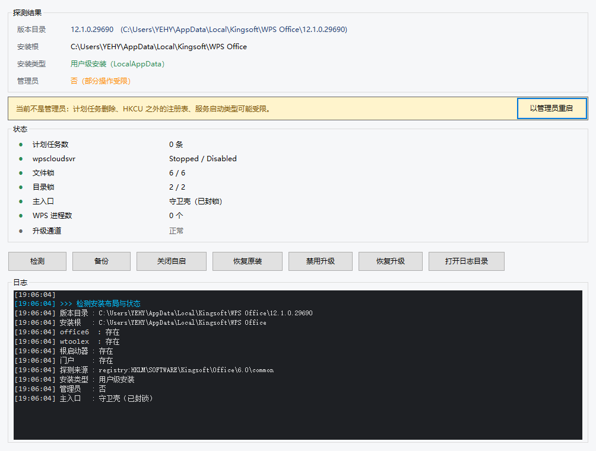

# WPS 开机自启关闭器 · 使用说明

一个单文件小工具，用来**彻底关掉 WPS Office 的开机自启**，同时保证你双击图标仍能正常打开 WPS，并且随时可以一键恢复原装。

适用对象：被 WPS「开机自己弹出来」困扰、在启动项管理 / 火绒 / 任务计划里删了又回来的人。

---

## 一、为什么常规办法没用

WPS 的自启**不在 `Run` 注册表里**，所以启动项管理和杀软清理启动项清的都是空气。它真正的机制是三层：

| 层 | 机制 | 具体表现 |
|---|---|---|
| 1 | 两条以你本人身份注册的计划任务 | `WpsUpdateLogonTask_<用户名>`（登录后延迟 29 分钟）、`WpsUpdateTask_<用户名>`（每小时），动作是 `ksolaunch.exe /wpsupdate -from=task -source=task` |
| 2 | **更新器会重建任务** | `wtoolex\wpsupdate.exe` 运行时会执行 `-createtask` / `-repairtask`，把你删掉的任务再建回来 |
| 3 | 安装完自己拉起 | `wps.exe /prometheus /from=autostart_after_install` |

所以只删条目必输。**必须让「载荷」跑不起来。**

---

## 二、这个工具怎么解决

| 步 | 动作 | 作用 |
|---|---|---|
| 1 | 结束 WPS 进程 | 释放文件占用 |
| 2 | 禁用 + 删除计划任务 | 拆掉触发源 |
| 3 | 清扫 `Run` / `RunOnce` | 兜底；**删除前先把原值（含 ValueKind）记进 manifest，恢复时回写** |
| 4 | **把 `ksolaunch.exe` 换成守卫壳** | 自启调用被静默吃掉，正常点图标仍转发给 `wpsoffice.exe` |
| 5 | **文件 ACL：`(X,WD,AD,WEA,WA,DE)`** | 更新器无法执行、无法被覆盖、无法被删除 |
| 6 | **目录 ACL：`(WD,AD)`** | 禁止在安装根新建版本目录，阻断升级后重建 |
| 7 | 服务 `wpscloudsvr` 设为 Disabled | 掐掉云文档后台常驻 |
| 8 | 复核 | 报告残留项 |

守卫壳的参数判定用 **token 精确匹配**：把命令行按空白切开、去掉前导 `-` 或 `/`、逐 token 比对 `wpsupdate` / `createtask` / `repairtask` / `from=task` / `source=task`，另外任何 token 含 `autostart` 也拦。其余一律放行。

---

## 三、运行环境

- Windows 7 SP1 / 10 / 11（x86 或 x64 均可，exe 是 AnyCPU）
- .NET Framework 4.0 或更高（Windows 10/11 自带）
- WPS 装在 `%LOCALAPPDATA%\Kingsoft\WPS Office` 时**普通用户即可**
- WPS 装在 `C:\Program Files*` 下时**必须右键 → 以管理员身份运行**

不需要 Python、不需要 Node、不需要 Visual Studio。

---

## 四、快速开始

### 第 1 步：运行程序

双击 `WpsAutostartKiller.exe`。程序启动后会自动做一次检测（只读，不改任何东西）。



### 第 2 步：看顶部探测结果

- **版本目录**：识别到的 WPS 版本文件夹，例如 `12.1.0.29690`
- **安装根**：上一级目录
- **安装类型**：绿色 `用户级安装（LocalAppData）` = 普通权限就行；橙色 `全局安装（Program Files）` = 必须管理员
- **管理员**：绿色 `是（可完整处置）` / 橙色 `否（部分操作受限）`

如果显示橙色「否」，点右上角 **以管理员重启**（会弹 UAC，点「是」）。

### 第 3 步：点「关闭自启」

会弹二次确认，列出将要执行的 6 个动作。确认后：

- 先自动生成备份目录 `backup-yyyyMMdd-HHmmss\`
- 然后依次执行上面的 8 个步骤
- 底部日志窗实时输出每一步结果，同时写一份到 `killer-yyyyMMdd.log`

完成后状态区应该全绿：

```
● 计划任务数      0 条
● wpscloudsvr     Stopped / Disabled
● 文件锁          6 / 6
● 目录锁          2 / 2
● 主入口          守卫壳（已封锁）
● WPS 进程数      0 个
```

### 第 4 步：验证

双击桌面 / 开始菜单 / 任务栏的 WPS 图标 —— 应该能正常打开，图标也还是原来那个。

重启一次，**开机后不要手动点 WPS**，等十几分钟看它有没有自己出现。再开本程序点「检测」，状态区仍全绿就说明成功。

更严格的判定见第八节。

---

## 五、界面各部分

### 顶部：探测结果卡片

四个字段，用颜色区分状态（绿色正常 / 橙色需注意 / 红色异常）。启动时自动检测一次，也可以随时点「检测」刷新。

### 黄色提示条

只在非管理员时出现，说明哪些操作会受限，右侧有「以管理员重启」。

### 中部：状态网格

七行，每行左侧圆点是 绿 / 黄 / 红 / 灰：

| 行 | 绿色 | 灰色 | 黄色 | 红色 |
|---|---|---|---|---|
| 计划任务数 | 0 条 | — | — | 有残留 |
| wpscloudsvr | Disabled | — | 其它启动类型 | — |
| 文件锁 | 全部锁住 | — | — | 有漏 |
| 目录锁 | 全部锁住 | — | — | 有漏 |
| 主入口 | 守卫壳（已封锁） | — | 原版程序（未封锁） | — |
| WPS 进程数 | 0 个 | — | 有进程 | — |
| 升级通道 | 已禁用 | 正常（未干预） | 未知（混合状态） | — |

「升级通道」单独说明：三个升级服务器值都指向 `127.0.0.1:9` 显示绿色「已禁用」；
都还是原始 `wps.cn` / `kingsoft` 域名显示灰色「正常」；部分被改或值缺失显示黄色「未知」。
详见第七节。

**「文件锁 N / M」里 M 的算法**（UI、`--selftest`、本文档三处口径一致）：

```
M = 下面这些候选里「当前实际存在」的文件个数
      office6\ksolaunch.exe
      wtoolex\wpsupdate.exe
      wtoolex\updateself.exe
      wtoolex\updatepolicy.exe
      安装根\ksolaunch.exe        （守卫壳）
      安装根\ksolaunch.real.exe   （原版备份）
```

后两个是「可执行但禁改禁删」，**同样计入**。所以典型全绿状态是 `6 / 6`，而不是 `4 / 4`。
老版本没有 `wtoolex` 时自然变成 `3 / 3` 或 `2 / 2`，不是异常。

### 底部：日志

带时间戳的只读日志，自动滚到底部，同时落盘到 exe 同目录的 `killer-yyyyMMdd.log`。

「打开日志目录」会打开 exe 所在文件夹。

---

## 六、七个按钮分别做什么

### 检测

只读。重新探测安装布局、计划任务、服务、锁状态、进程数。**不改任何东西**，随便点。

### 备份

只导出计划任务 XML 到 `backup-<时间>\`。轻量备份，用于手工排查。

> 完整的备份（含 manifest、5 个文件 SHA256、注册表导出、服务类型、ACL 现状）是在点「关闭自启」时**自动**做的，不需要单独点「备份」。

### 关闭自启

会二次确认。动作清单见第二节。全过程可回滚。

### 恢复原装

会二次确认。读最新的 `backup-*\manifest.json`，逆向执行：
1. **解除所有 DENY ACL** —— 候选集合是 `files[]` ∪ `fileRecords[]` ∪ 现场探测到的路径的并集。
   `ksolaunch.real.exe` 是关闭自启过程中才由 `File.Move` 产生的，首次备份时它并不存在，
   所以光靠 `files[]` 会漏掉它；`fileRecords[]` 里即使 `existedAtBackup=false` 也照样参与解锁。
2. 删除守卫壳，把 `ksolaunch.real.exe` 改回 `ksolaunch.exe`（改名前三处 DENY 都会先摘掉）
3. 用备份的 XML 重建计划任务
4. `wpscloudsvr` 启动类型恢复
5. **回写 `Run` / `RunOnce`** —— 按 `runValues[]` 用 `Registry.SetValue` 写回原始值，保留原始 `ValueKind`（`REG_SZ` / `REG_EXPAND_SZ` / `REG_BINARY` …）和未展开的 `%windir%` 形式
6. **锁残留复核** —— 再读一遍原版文件的 ACL，若仍有 DENY 会在日志里记一条 `WARN：仍有 DENY 残留，不是干净原装`

恢复后 WPS 的自动更新、自己重建自启任务、开机自启**全部回归**——这就是「原装」的定义。

### 禁用升级

独立操作，**不并入「关闭自启」**。会二次确认，弹窗里列清将要改的三个注册表值名与目标地址。
原值先写入 `upgrade-before.json`，随时可以「恢复升级」还原。详见第七节。

### 恢复升级

独立回滚，只还原三个升级服务器地址，不动自启相关的任何东西。
优先读 `upgrade-before.json`，没有则读 `upgrade-backup-*\manifest.json` 或 `backup-*\manifest.json` 的 `upgradeValues`。

> **两个功能互相独立**：只禁升级不关自启、只关自启不禁升级、或者两个都做，都能分别执行、分别回滚。

### 打开日志目录

用资源管理器打开 exe 所在文件夹，方便查看 `killer-<日期>.log`、`backup-*\`、`upgrade-before.json` 等产物。

> 上面 7 个按钮从左到右依次是：**检测 · 备份 · 关闭自启 · 恢复原装 · 禁用升级 · 恢复升级 · 打开日志目录**。

---

## 七、禁用 WPS 升级（独立功能）

这一节是**独立操作**，跟「关闭自启」互不影响：可以只禁升级不关自启，也可以反过来，各自单独回滚。

### 7.1 原理：三步链路

WPS 的更新器（`wtoolex\wpsupdate.exe`、`wtoolex\updateself.exe`）在运行时读取三个服务器地址：

```
HKCU\SOFTWARE\Kingsoft\Office\6.0\Common
  UpdateSvr     升级服务地址（明文）
  UpdateSecSvr  升级服务地址（HTTPS）
  NotifySvr     升级通知地址
```

本机的原始值是分号分隔的多地址串：

```
UpdateSvr    = http://update.wps.cn/updateserver/update;http://update2.wps.cn/updateserver/update
UpdateSecSvr = https://update.wps.cn/updateserver/update;https://update2.wps.cn/updateserver/update
NotifySvr    = http://notify.wps.cn/notifyserver/notify
```

把这三个地址改到本机回环后，链路就断在第一步：

```
更新器读配置 → 请求 127.0.0.1:9 → 连接被拒 → 拿不到升级模板 → 不下载、不安装 → 不会重建计划任务
```

### 7.2 为什么用端口 9

`9` 是 RFC 863 定义的 **Discard** 端口，正常情况下没有任何程序监听。

- 连接本机未监听端口，TCP 栈会**立即回 RST**，更新器毫秒级拿到「连接被拒」
- 如果换成黑洞 IP 或不存在的域名，更新器会一直等到超时，每次启动都要卡几秒到几十秒
- 指向 `127.0.0.1` 也不会触发任何外网请求，比改 hosts 更彻底、且可逆

### 7.3 操作

点 **「禁用升级」** → 二次确认（弹窗里会列清三个值名与目标地址）→ 自动执行：

1. 读出三个原值（任何一个不存在就记「跳过」，**不会凭空创建**）
2. 写备份：`upgrade-before.json`（exe 同级）+ `upgrade-backup-<时间>\manifest.json`
3. 逐个写入，日志打印「写入前 → 写入后」
4. 读回确认，打印每条是否一致

日志用单独的分区标题，便于和自启操作区分：

```
──────── 升级通道 · 禁用 ────────
=== 禁用 WPS 升级 ===
注册表位置：HKCU\SOFTWARE\Kingsoft\Office\6.0\Common
已写备份：...\upgrade-before.json
  UpdateSvr     写入前 = http://update.wps.cn/updateserver/update;http://update2.wps.cn/updateserver/update
                写入后 = http://127.0.0.1:9/updateserver/update   [REG_SZ]
  ...
读回确认：...
────────────────────────────────
```

HKCU 写入**不需要管理员**，普通用户直接可用。

### 7.4 怎么验证

状态网格第 7 行「升级通道」有三态：

| 显示 | 圆点 | 含义 |
|---|---|---|
| 已禁用 | 绿 | 三个值都指向 `127.0.0.1:9` |
| 正常 | 灰 | 三个值都还是 `wps.cn` / `kingsoft` 域名 |
| 未知（混合状态） | 黄 | 部分被改、或值缺失、或指向其它地址 |

命令行也能查：

```powershell
.\WpsAutostartKiller.exe --upgrade-state
```

或看 `--selftest` 的这一行：

```
升级通道    : 正常  UpdateSvr=http://update.wps.cn/updateserver/update;http://update2.wps…
```

想亲眼确认写/还原都可靠，跑往返自测（改完**立刻**还原）：

```powershell
.\WpsAutostartKiller.exe --upgrade-test
```

它会打印「改动前 → 写入 → 读回断言 → 还原 → 再读回断言（含 endsWith 校验）」的完整对照，并给出结论。

### 7.5 怎么恢复

点 **「恢复升级」**，按以下顺序找备份：

1. exe 同级的 `upgrade-before.json`
2. 最新的 `upgrade-backup-*\manifest.json`
3. 最新 `backup-*\manifest.json` 里的 `upgradeValues`

找到就按原始 `ValueKind` 写回并打印对照；三者都没有会明确提示「没有升级配置备份，请手工恢复」并列出原始值。

命令行：`.\WpsAutostartKiller.exe --upgrade-restore`

### 7.6 重复点「禁用升级」安全吗

**安全，是幂等的。** 分两种情况：

| 情况 | 程序行为 |
|---|---|
| 三个值已经是 `127.0.0.1:9` | 直接提示「已处于禁用状态，跳过。未做任何写入，也未覆盖任何备份。」，**不写注册表、不动备份文件** |
| 已经是禁用状态、但你手动把值改回了官方地址 | 正常再禁用一次，此时读到的是干净的官方地址，备份不会被污染 |

**它做了什么来防止"把备份写坏"**：

- `upgrade-before.json` **已存在且内容干净**（不含 `127.0.0.1`）时，**不覆盖**，新快照另存为 `upgrade-before-<时间戳>.json`
- 已存在但内容**含** `127.0.0.1`（说明是历史污染的）时，才允许覆盖并修正，日志会写明「检测到已有…内容含 127.0.0.1（历史污染），用本次干净值覆盖修正」

**为什么要这么设计**：如果第二次禁用时无条件覆盖，读到的"原值"就是 `127.0.0.1:9`，真正的原始地址会被抹掉，之后再点恢复只会把黑洞地址写回去——看着恢复了，实际还是断的。

### 7.7 备份会被污染时怎么救

如果你不确定手上的备份文件干不干净，恢复流程自带防护：

- 读取每一级备份时都会校验：**只要 `originalValue` 里含 `127.0.0.1`，就判定该文件不可用并跳过**，日志会打印「跳过 …：其中的 originalValue 含 127.0.0.1，不是可用的原值备份」，然后自动往下一级找
- 写回之前还有一道断言：**拒绝把 `127.0.0.1` 写回注册表**，记一条拒绝并计入结论，不会静默成功

所以即使某个备份被污染，只要有任意一级是干净的，恢复依然能回到官方地址。

### 7.6 重装 WPS 后需要重做

升级地址存在 `HKCU` 的用户配置里，**WPS 重装 / 大版本升级 / 新建用户配置**都可能重置或重写这三个值。
装完重新点一次「禁用升级」，或看状态网格第 7 行是否变回灰色。

> 注意：禁用升级只解决「WPS 自己偷偷升级」。它不替代「关闭自启」——两者机制不同，建议两个都做。

## 八、备份目录里有什么

```
backup-20261127-183000\
  manifest.json            恢复清单 —— 字段见下
  acl-before.txt           改动前的 ACL 快照
  hash-before.csv          载荷文件的 SHA256
  HKCU-Kingsoft.reg        HKCU\SOFTWARE\Kingsoft 全量导出
  service-before.txt       wpscloudsvr 改动前状态
  upgrade-before.json      三个升级服务器地址的原值（3 项，可直接用于恢复升级）
  WpsUpdateTask_xxx.xml    计划任务 XML（有几条导几条）
  WpsUpdateLogonTask_xxx.xml
  guard-build.log          守卫壳编译日志
```

`manifest.json` 的字段：

| 字段 | 内容 |
|---|---|
| `createdAt` / `user` / `isAdmin` | 备份时间、执行账户、是否管理员 |
| `layout` | `{versionDir, rootDir, office6, wtoolex, machineWide, foundBy}` |
| `versionDir` / `rootDir` | 同上，扁平版（老版本兼容） |
| `launcherRoot` / `launcherReal` | 主入口与原版备份的绝对路径 |
| `originalHash` | 原版 `ksolaunch.exe` 的 SHA256，恢复时用于校验 |
| `files[]` | 备份时**存在**的候选文件 |
| `fileRecords[]` | 全部候选，每项带 `existedAtBackup` —— 关自启后才产生的 `.real` 也在这里 |
| `dirs[]` | 施加了目录锁的目录 |
| `tasks[]` / `taskNames[]` / `taskXmls[]` | 计划任务名与 XML 路径 |
| `services[]` | `{name, originalStartMode, stateAtBackup}` |
| `runValues[]` | `{root, subkey, name, kind, value, matched}` —— Run/RunOnce 原始值，恢复时回写 |
| `upgradeValues[]` | `{name, originalValue, newValue, kind, appliedAt}` —— 升级服务器地址的留档 |

**这些文件不要删**，否则「恢复原装」会失去依据。

### 升级功能产生的额外文件

点「禁用升级」时除了备份目录，还会单独生成两份，方便**只恢复升级**而不碰整份 manifest：

```
upgrade-before.json                     exe 同级，恢复升级时优先读它
upgrade-backup-20261127-190539\
  manifest.json                         含 upgradeValues[]
  upgrade-before.json                   同内容副本
```

点「备份」时也会在每个 `backup-<时间>\` 目录里放一份 `upgrade-before.json`（内容同构：`name / originalValue / kind`），
所以**只做备份、没做禁用升级**的情况下也能单独恢复升级；两份路径产物是对称的。

字段 `name / originalValue / newValue / kind / appliedAt`，`originalValue` 是完整的分号分隔多地址串。

> 不想执行「关闭自启」又想检查 manifest：跑 `WpsAutostartKiller.exe --backup-only`，
> 它只读注册表/文件/任务并生成一份完整备份目录，不杀进程、不改 ACL、不动服务。

---

## 九、开机后判定怎么读

工具读的是 WPS **自己写**的两个时间戳（epoch 毫秒），跟本次开机时间比：

```
HKCU\SOFTWARE\Kingsoft\Office\6.0\wpsoffice\Application Settings\coldStartup
HKCU\SOFTWARE\Kingsoft\Office\6.0\qing\Application Settings\coldStartup
```

判定结果三种：

| 显示 | 含义 |
|---|---|
| `（开机之前）` + `判定：干净` | 本次开机后 WPS 没启动过 ✅ |
| `← 开机之后` + `判定：本次开机后 WPS 启动过` | 自启还在，需要排查 |
| `（无值，WPS 从未在本机启动过）` | 全新机器还没开过 WPS |

这个判据的好处：**不依赖你盯着屏幕**。WPS 哪怕启动 3 秒就退出，时间戳也会变。

也可以直接看守卫壳自己的日志（每次调用都留痕）：

```powershell
Get-Content "$env:LOCALAPPDATA\Kingsoft\wps-guard.log" -Tail 10
```

- `LAUNCH  args=[...] -> ...\wpsoffice.exe` 正常转发
- `BLOCKED args=[...]` 自启/更新请求被拦下（这是好事）
- `NO-TARGET` 找不到主程序，需要重跑一次「关闭自启」
- `FAIL ... err=` 启动抛异常

---

## 十、命令行模式

### `--selftest` 自检

无窗口运行，探测结果打到 stdout，退出码 0，同时在 exe 同目录落一份 `selftest-<时间>.log`。

### `--backup-only` 只备份

同样无窗口，只跑备份流程：读注册表 / 文件 / 计划任务，生成一个完整的 `backup-<时间>\` 目录，
**不杀进程、不改 ACL、不动服务、不碰注册表**。用于：

- 验收 / 审计：确认 `manifest.json` 字段是否齐全
- 先留一份现场再决定要不要动手

输出里会带一段字段检查表和 `manifest.json` 原文。

### `--upgrade-state` / `--upgrade-disable` / `--upgrade-restore` / `--upgrade-test`

| 参数 | 作用 |
|---|---|
| `--upgrade-state` | 打印升级通道三态与三个值当前内容 |
| `--upgrade-disable` | 禁用升级（等价于点按钮，带备份与读回确认） |
| `--upgrade-restore` | 恢复升级（按 `upgrade-before.json` → `upgrade-backup-*` → `backup-*` 的顺序找备份） |
| `--upgrade-test` | **往返自测**：备份 → 改 → 读回断言 → 立刻还原 → 再读回断言（含 endsWith 校验），退出码 0 表示双向可靠 |

`--upgrade-test` 只在本机做一次「改完立刻还原」，适合验收；正常使用请走 UI 或 `--upgrade-disable`。

### 捕获输出

**推荐用管道或重定向捕获（PowerShell）：**

```powershell
$exe = ".\WpsAutostartKiller.exe"
$psi = New-Object System.Diagnostics.ProcessStartInfo $exe, '--selftest'   # 或 '--backup-only'
$psi.UseShellExecute = $false
$psi.RedirectStandardOutput = $true
$p = [System.Diagnostics.Process]::Start($psi)
$out = $p.StandardOutput.ReadToEnd()
$p.WaitForExit()
$out
"退出码: $($p.ExitCode)"
```

或者最简单：跑一次，然后读同目录的 `selftest-*.log`。

> **注意**：不要用 `WpsAutostartKiller.exe --selftest > out.txt` 这种 cmd 重定向。
> cmd 对 GUI 子系统程序不等待就关闭了重定向句柄，文件会是 0 字节——这是 cmd 的行为，不是程序没输出。要重定向请套一层：`cmd /c "powershell -Command \"& '路径\WpsAutostartKiller.exe' --selftest | Out-File out.txt\""`。

---

## 十一、从源码编译

```cmd
build.cmd
```

编译命令（`build.cmd` 里就是这一条）：

```cmd
%WINDIR%\Microsoft.NET\Framework64\v4.0.30319\csc.exe /nologo /target:winexe /platform:anycpu /optimize+ /codepage:65001 /r:System.dll /r:System.Core.dll /r:System.Drawing.dll /r:System.Windows.Forms.dll /r:System.ServiceProcess.dll /win32icon:assets\wps.ico /out:WpsAutostartKiller.exe WpsAutostartKiller.cs
```

几个必须保留的参数：

| 参数 | 原因 |
|---|---|
| `/codepage:65001` | 源码是 UTF-8，不加这个中文会按 ANSI 解码成乱码 |
| `/win32icon:assets\wps.ico` | 不加的话 exe 图标是系统默认图标 |
| `/r:System.ServiceProcess.dll` | 查询 `wpscloudsvr` 服务要用 |
| `/r:System.Windows.Forms.dll` | WinForms |

目录结构：

```
02-auto\
  WpsAutostartKiller.exe     编译产物
  WpsAutostartKiller.cs      主程序源码（单文件，含内嵌守卫壳源码的 base64 回退）
  build.cmd                  一键编译
  使用说明.md                本文档
  assets\
    WpsLaunchGuard.cs        守卫壳源码（独立文件，便于审阅）
    wps.ico                  程序图标（16/32/48/256 多尺寸）
    screenshot.png           界面截图
```

运行时守卫壳的图标是**从原版 `ksolaunch.exe` 现场提取**的（`PrivateExtractIcons` 取 16/32/48/256，手工拼 ICO），所以换机器换版本也能拿到正确的 WPS 图标；提取失败才回退到 `assets\wps.ico`。

---

## 十二、已知边界

1. **WPS 重装或大版本升级会重置 ACL**，自启会复活。装完重跑一次「关闭自启」即可。
2. **全局安装在 Program Files 时必须管理员**，否则 ACL 改不动、任务删不掉。程序会检测并在顶部标橙色。
3. **老版本 / 专业版可能没有 `wtoolex` 目录，也没有根级 `ksolaunch.exe`**。程序会跳过不存在的组件，不报错；但没有根启动器时就没有守卫壳，此时只靠「删任务 + 锁更新器」。
4. **计划任务的 DACL 可能只给读权限**（WPS 用管理员上下文注册的那种），删除会失败。程序不会中断，而是降级为「已禁用」并提示需要管理员再删一次。
5. 任何以管理员身份运行的 WPS 修复工具、或你自己手动跑安装包，都能绕过这套限制——那属于「主动安装」，不在自启范畴。
6. **WPS 重装 / 大版本升级 / 新建用户配置可能重置升级服务器地址**。装完重新点一次「禁用升级」，或看状态网格第 7 行是否变回灰色。
7. **升级地址在 HKCU，普通用户即可修改**，不需要管理员；但这也意味着**换 Windows 用户后需要在新用户下重做一次**。

---

## 十三、三条硬规则（改代码前必读）

这些都是实际踩过的事故，不是理论洁癖。

### 1. ACL 必须用精确权限位

```
文件：(X,WD,AD,WEA,WA,DE)
目录：(WD,AD)
```

**绝对不要用 `icacls` 的简写 `W`。** `W` 是泛型写权限，会连带拒绝 `READ_CONTROL`，实测后果是文件连读都读不了、WPS 直接起不来。

### 2. 守卫壳参数判定必须 token 精确匹配

按空白切分 → 去掉前导 `-` 或 `/` → 逐 token 比对。

**绝对不要用子串包含。** 两次事故：

- 拦截词里写了 `/prometheus`，而它是 WPS **正常启动**标志（快捷方式实参是 `/prometheus /fromksolaunch /from=startmenu`，文件关联是 `wps.exe /prometheus /wps "%1"`）→ 点图标毫无反应
- 拦截词 `from=task` 是 `from=taskbar` 的子串 → 任务栏固定图标点了没反应

### 3. 替换主入口前必须先移除 DENY

```powershell
icacls "<安装根>" /remove:d "DOMAIN\USER"
icacls "<ksolaunch.exe>" /remove:d "DOMAIN\USER"
```

不移除就重命名/覆盖，会报 `Access denied`。程序里在 `Killer.Run` 的第 4 步做了这两次 `RemoveDeny`。

---

## 十四、故障排查

| 现象 | 查什么 |
|---|---|
| 点图标没反应 | `Get-Content "$env:LOCALAPPDATA\Kingsoft\wps-guard.log" -Tail 5`，看是 `LAUNCH` 还是 `BLOCKED` |
| 日志显示 `BLOCKED` 但你在正常打开 | 拦截词还需收窄，把那一行发给我 |
| 状态区「主入口 原版程序（未封锁）」 | 守卫壳没装上，重跑「关闭自启」 |
| 「文件锁 4 / 6」 | 有文件被还原了（多半是 WPS 更新过），重跑「关闭自启」 |
| 任务数不为 0 | 需要管理员权限删，点「以管理员重启」后重试 |
| 恢复原装后图标变默认 | 图标缓存问题，注销重登一次 |
| 升级通道显示「未知（混合状态）」 | 三个值只改了一部分，点「恢复升级」回到原值后重做 |
| 升级通道显示「未找到配置」 | WPS 未安装或版本不同，该功能不适用 |
| 恢复了升级但 WPS 又自己更新 | 说明当初改的不是这三个值之外还有别的通道，或重装覆盖了配置，重跑「禁用升级」并看状态行是否变绿 |
